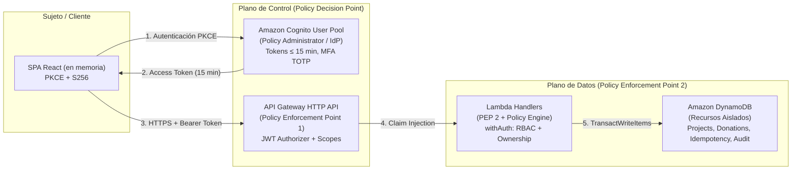

# Modelo de Amenazas y Mapeo NIST SP 800-207 — Plataforma de Donaciones Seguras

**Proyecto:** Plataforma de Donaciones Seguras (Fundación AQP-SOLIDARIA)  
**Estándar de Seguridad:** NIST Special Publication 800-207 (Zero Trust Architecture)  
**Metodología de Análisis de Amenazas:** STRIDE + OWASP Top 10:2025  
**Estado:** Completo (T107)

---

## 1. Alcance, Supuestos y Filosofía de Diseño

- **Proyecto Académico con Simulación Controlada:** Se modela una plataforma de donaciones sociales donde las transacciones son **simuladas** (`PENDIENTE_SIMULACION`, `CONFIRMADA_SIMULADA`, `RECHAZADA_SIMULADA`). No se procesan pagos reales ni se recolectan o transmiten números de tarjeta de crédito/débito, códigos CVV ni datos bancarios.
- **Premisa Fundamental Zero Trust (NIST SP 800-207):** Ninguna solicitud es confiable por su ubicación física, dirección IP o pertenencia a una red privada. La confianza implícita dentro del perímetro de red se elimina por completo.
- **Backend como Única Fuente de Verdad:** Ni el navegador ni los parámetros de entrada (`body`, `query`, headers personalizados) determinan la identidad (`sub`), el rol (`cognito:groups`), el estado del proyecto ni el importe acumulado. Todo valor crítico proviene exclusivamente del token JWT verificado y del estado atómico en la base de datos persistente.

---

## 2. Mapeo Formal a NIST SP 800-207 (Zero Trust Architecture)

El estándar NIST SP 800-207 define los principios y componentes esenciales de una arquitectura Zero Trust (ZTA). A continuación se documenta el mapeo punto por punto:

### 2.1 Los 7 Principios Fundamentales de NIST SP 800-207

| Principio NIST SP 800-207 | Requisito del Estándar | Implementación en la Plataforma | Evidencia / Verificación |
|---|---|---|---|
| **1. Todos los orígenes de datos y servicios de cómputo se consideran recursos.** | Ninguna función interna ni tabla queda desprotegida; cada endpoint HTTP API y cada tabla DynamoDB es un recurso independiente. | 9 funciones Lambda desacopladas, 4 tablas DynamoDB dedicadas y bucket S3 privado con CloudFront OAC. | `infra/template.yaml`, `backend/test/unit/projects/iam.test.ts`. |
| **2. Toda la comunicación es segura sin importar la ubicación de la red.** | Toda comunicación debe estar cifrada en tránsito y en reposo; sin tráfico en texto claro. | HTTPS obligatorio (TLS 1.2+ en CloudFront y API Gateway); cifrado en reposo (`AWS_OWNED_KMS_KEY`) en DynamoDB y S3. | `template.yaml` (`ViewerProtocolPolicy: redirect-to-https`). |
| **3. El acceso a recursos individuales se concede por sesión.** | No hay confianza persistente entre solicitudes consecutivas; cada petición debe autenticarse y autorizarse independientemente. | Cada solicitud porta un `Authorization: Bearer <access_token>` de corta duración evaluado en cada invocación por el middleware `withAuth`. | `backend/src/authz/middleware.ts`, `auth.tokens.test.ts`. |
| **4. El acceso se determina mediante una política dinámica.** | Evaluación de atributos del sujeto (`sub`, `roles`), acción solicitada y estado del recurso en la base de datos (ABAC/RBAC). | `authorize(principal, action)` valida roles; `canAccessProject` / `canAccessDonation` evalúan propiedad contra DynamoDB. | `backend/src/authz/policies.ts`, `authz.roles.test.ts`. |
| **5. La organización monitorea y mide la integridad y postura de seguridad de todos los activos.** | Monitoreo de solicitudes, correlación y registro de eventos sin filtrar datos sensibles. | Logging JSON estructurado uniforme con `requestId`, acción, resultado y duración en todas las Lambdas hacia CloudWatch Logs (14 días retención). | `backend/src/shared/logger.ts`, `logger.test.ts`, `template.yaml`. |
| **6. Toda autenticación y autorización es dinámica y estrictamente aplicada antes de permitir el acceso.** | Las puertas de enlace deben rechazar peticiones no autenticadas antes de alcanzar la lógica de negocio. | Verificación en dos capas: capa 1 en API Gateway HTTP API (JWT Authorizer nativo con scopes); capa 2 en middleware Lambda (`token_use=access`, emisor, cliente, reloj). | `template.yaml` (`CognitoJwt`), `authz/middleware.ts`, `authz.errors.test.ts`. |
| **7. Se recopila información sobre el estado de la red, infraestructura y comunicaciones para mejorar la postura.** | Auditoría inmutable de acciones privilegiadas y de mutación de datos. | Tabla `AuditEvents` en DynamoDB registra creaciones de proyectos, publicaciones, donaciones y simulaciones con `requestId` y huella SHA-256. | `backend/src/projects/repository.ts`, `backend/src/donations/repository.ts`. |

### 2.2 Componentes Lógicos de ZTA (NIST SP 800-207)

- **Policy Enforcement Point (PEP 1 - Perímetro):** Amazon API Gateway HTTP API valida criptográficamente la firma del JWT contra las claves JWKS de Cognito, verifica vigencia (`exp`), emisor (`iss`), audiencia (`aud` / `client_id`) y scopes (`AuthorizationScopes`).
- **Policy Enforcement Point (PEP 2 - Host):** Middleware `withAuth` en Lambda realiza validación en profundidad: rechaza tokens con `token_use !== 'access'`, comprueba que `sub` sea un UUID válido y verifica que el rol pertenezca a la lista autorizada.
- **Policy Decision Point (PDP / Policy Engine):** Módulo `backend/src/authz/policies.ts` evalúa la matriz de permisos matricial (RBAC) y la propiedad de recursos persistidos (ABAC/Ownership) frente a DynamoDB.
- **Policy Administrator (PA):** Amazon Cognito User Pool administra el ciclo de vida de usuarios, asignación de grupos (`DONANTE`, `GESTOR`, `AUDITOR`) y el desafío MFA obligatorio.

---

## 3. Limitación conocida: revocación del access token (CA-03.4)

**Qué ocurre.** El JWT authorizer de API Gateway valida la firma, el emisor, la expiración, la audiencia y los scopes del access token, pero **no consulta si el token fue revocado**. Por tanto, un access token revocado antes de su expiración **sigue siendo aceptado hasta que expira**; después de expirar se rechaza con 401. El backend tampoco mantiene una lista de revocación: su decisión depende solo de los claims y del reloj.

**Qué sí se revoca.** Al cerrar sesión (o al revocar el token en Cognito) se revoca el **refresh token**: nadie puede obtener nuevos access tokens a partir de esa sesión.

**Mitigación.** La vida corta del access token acota la ventana de exposición: como máximo **15 minutos** desde la emisión. No se introducen access tokens de larga duración ni se persisten en el navegador.

**Riesgo residual aceptado.** Durante esos minutos, un access token robado y ya revocado todavía serviría. Se acepta por el alcance académico; una lista de revocación consultada en cada solicitud (por ejemplo, un authorizer Lambda propio) queda fuera del MVP.

### Cómo se verifica

- **Verificado en pruebas automáticas (sin AWS):** el backend acepta un token hasta su `exp` y lo rechaza desde ese instante, sin consultar ningún almacén (`backend/test/unit/authz/principal.test.ts` y `backend/test/integration/auth.tokens.test.ts`); la vigencia configurada es ≤ 15 minutos (`infra/template.yaml`, comprobada por `auth.tokens.test.ts`).
- **Pendiente de despliegue (no se simula):** la demostración extremo a extremo con un User Pool y una API Gateway reales —usar un access token después de cerrar sesión, comprobar que aún se acepta hasta expirar y que luego da 401— se ejecuta con el procedimiento de `evidence/auth-pending-deployment.md`.

## 4. Arquitectura de Tokens y Gestión de Sesión

| Atributo | Decisión Arquitectónica | Justificación de Seguridad |
|---|---|---|
| **Flujo de Autorización** | Authorization Code Flow con PKCE (RFC 7636, S256). | La SPA es un cliente público. PKCE mitiga el robo de códigos de autorización en tránsito sin requerir un `client_secret` en el navegador. Flujo implícito prohibido. |
| **Vigencia del Access Token** | Máximo **15 minutos** (configurable a 5 min). | Acota la ventana temporal de exposición ante eventual interceptación o revocación previa. |
| **ID Token vs Access Token** | El ID token **no** es una credencial de API. | Los endpoints de API Gateway exigen `token_use=access` y scopes dedicados (`api/donations.write`, `api/projects.write`). El uso de ID tokens es rechazado con `401 Unauthorized`. |
| **Refresh Token** | 1 día de vigencia; revocable (`EnableTokenRevocation: true`). | Permite revocar la sesión globalmente y obtener nuevos access tokens solo mientras la cuenta permanezca activa. |
| **Almacenamiento en Cliente** | **Exclusivamente en memoria** (variables React / closures). | Se prohíbe terminantemente `localStorage` y `sessionStorage` para guardar tokens, neutralizando el robo pasivo vía Cross-Site Scripting (XSS). |
| **Estado Transitorio PKCE** | `sessionStorage` temporal solo para `state` y `code_verifier`. | Necesario para sobrevivir a la redirección externa de Cognito Hosted UI; se purga inmediatamente tras el intercambio del token. |
| **Cierre de Sesión (Logout)** | Cierre de sesión de tres fases: 1) Revocación de refresh token vía Cognito; 2) Purga de memoria en la SPA; 3) Redirección a `/logout` de Cognito Hosted UI. | Garantiza la eliminación de credenciales en el cliente y la invalidación del refresh token en el IdP. |

---

## 4. Limitaciones Conocidas, Riesgos Residuales y Tratamiento

### 4.1 Ventana de Revocación de Access Token (CA-03.4)
- **Vulnerabilidad / Comportamiento:** API Gateway valida tokens JWT de manera descentralizada usando JWKS locales cacheados. No consulta en tiempo real al endpoint de Cognito para verificar si el usuario ha cerrado sesión o si el access token ha sido revocado.
- **Mitigación Implementada:**
  - Vida corta del access token: máximo 15 minutos (mínimo de Cognito: 5 min).
  - Al cerrar sesión se revoca inmediatamente el refresh token impidiendo nuevas emisiones.
- **Riesgo Residual Aceptado:** Durante un intervalo máximo de 15 minutos, un access token capturado antes del logout podría seguir siendo técnicamente aceptado por API Gateway. Se considera un riesgo residual aceptado para el alcance académico, documentado y controlado.

### 4.2 Restricción de MFA en Cognito User Pools (US5)
- **Comportamiento:** AWS Cognito User Pools aplica la política de MFA (`MfaConfiguration: REQUIRED`) a nivel de todo el pool de usuarios, no de manera condicional por grupo (`cognito:groups`).
- **Tratamiento Aplicado:** Se exige MFA TOTP (software token) a todos los usuarios que inicien sesión. No se habilita SMS para evitar ataques de SIM-swapping e incurrir en costos fuera del Free Tier.

### 4.3 Redirección de Error en Scopes de API Gateway (T11)
- **Comportamiento:** Cuando una solicitud porta un token sin los scopes requeridos por la ruta (por ejemplo, un ID token en lugar de un access token), API Gateway HTTP API puede emitir `403 Forbidden` antes de llegar a la Lambda.
- **Tratamiento:** Se documenta en el modelo y en las pruebas de integración que la protección perimetral opera como un filtro estricto de denegación por defecto.

---

## 5. Análisis de Amenazas STRIDE

| Categoría STRIDE | Amenaza Concreta | Vector de Ataque | Control Implementado | Evidencia / Pruebas |
|---|---|---|---|---|
| **Spoofing** (Suplantación) | Solicitud falsa haciéndose pasar por otro donante o gestor. | Envío de header `Authorization` alterado, vencido o con `sub` inyectado en el cuerpo JSON. | Validación criptográfica de firma JWT, verificación de `iss`, `aud`, `exp`, `token_use=access`. El backend ignora campos de identidad en el body y usa únicamente el claim `sub` verificado. | `backend/test/unit/authz/principal.test.ts`, `backend/test/integration/auth.tokens.test.ts`. |
| **Tampering** (Manipulación) | Modificación de montos donados, alteración de estados de proyecto o alteración de cargas de idempotencia. | Manipulación de campos en tránsito (e.g. intentar enviar `status: "PUBLICADO"` al crear proyecto, o repetir `Idempotency-Key` con importe distinto). | Esquemas Zod estrictos (`strip` / `reject`), serialización canónica SHA-256 en idempotencia (`payloadHash`), y escritura atómica con `TransactWriteItems`. | `packages/shared/src/canonical.ts`, `backend/test/unit/donations/idempotency.test.ts`, `donations.create.test.ts`. |
| **Repudiation** (Repudio) | Un gestor o donante niega haber realizado una publicación, donación o simulación. | Argumentar falta de registro o acción de terceros. | Registro inmutable de eventos en la tabla `AuditEvents` en DynamoDB con `requestId`, `actorSub`, `timestamp`, `action` y huella hash de la transacción. | `backend/src/projects/repository.ts`, `backend/src/donations/repository.ts`. |
| **Information Disclosure** (Fuga de Información) | Enumeración de proyectos privados (BOLA) o exposición de donantes y montos individuales. | Consultar IDs de proyectos en borrador o IDs de proyectos ajenos esperando distinguir entre no existente y no autorizado (403 vs 404). | Respuesta `404 Not Found` uniforme e indistinguible para recursos inexistentes o ajenos. El catálogo y detalle nunca devuelven listas de donantes ni `donorSub`. | `backend/test/unit/projects/detail.test.ts`, `backend/test/unit/donations/history.test.ts`. |
| **Denial of Service** (Denegación de Servicio) | Saturación de endpoints Lambda o agotamiento de capacidad en DynamoDB por ráfagas concurrentes. | Inundación de solicitudes HTTP o envíos masivos con la misma clave de idempotencia. | Throttling en API Gateway (DefaultRouteSettings con RateLimit y BurstLimit), y reintentos con jitter exponencial ante `TransactionConflictExceptions` (hasta 5 intentos). | `infra/template.yaml`, `backend/src/donations/repository.ts`, `donations.concurrent.test.ts`. |
| **Elevation of Privilege** (Elevación de Privilegios) | Un usuario con rol `DONANTE` intenta crear o publicar proyectos, o leer donaciones ajenas. | Inyectar `cognito:groups: ["GESTOR"]` en parámetros de petición o invocar rutas protegidas sin autorización. | Los roles se leen únicamente del claim `cognito:groups` del JWT verificado. La matriz de políticas de autorización (`authorize(principal, action)`) rechaza con `403 Forbidden` cualquier acción no autorizada. | `backend/test/unit/authz/policies.test.ts`, `backend/test/integration/authz.roles.test.ts`. |

---

## 6. Controles Financieros y Manejo de Idempotencia

1. **Aritmética Monetaria Entera:** Se prohíbe el uso de tipos de datos de punto flotante (`float`, `double`, `number` decimal) para montos financieros. Todos los importes se procesan y almacenan en céntimos enteros de Soles (`amountCents`, integer, entre 100 y 100000, equivalente a S/ 1.00 hasta S/ 1,000.00). La moneda está fijada de manera inmutable en `PEN`.
2. **Idempotencia Transaccional:** Cada donación exige una cabecera `Idempotency-Key` en formato UUID v4 (normalizada a minúsculas).
   - Se genera una huella SHA-256 de la carga JSON serializada en orden canónico (claves ordenadas alfabéticamente, sin espacios no significativos).
   - Se ejecuta una transacción `TransactWriteItems` de DynamoDB que condiciona la inserción simultánea en la tabla `Donations` y en la tabla `Idempotency`.
   - Si la clave ya fue procesada con la **misma** carga, el sistema devuelve la respuesta original almacenada (`201 Created`).
   - Si la clave se reutiliza con una carga **diferente**, el sistema rechaza inmediatamente la transacción con `409 Conflict`.
3. **Simulación Atómica de Transiciones de Estado:**
   - Una donación nace en estado `PENDIENTE_SIMULACION`.
   - La transición a `CONFIRMADA_SIMULADA` o `RECHAZADA_SIMULADA` se ejecuta mediante una transacción condicional atómica en DynamoDB.
   - Si la donación se confirma, se incrementan atómicamente los contadores agregados del proyecto (`confirmedAmountCents` y `donationCount`).
   - Intentos concurrentes o repetidos de simular una donación ya procesada fallan con `409 Conflict`, previniendo de forma estricta el doble cómputo.
